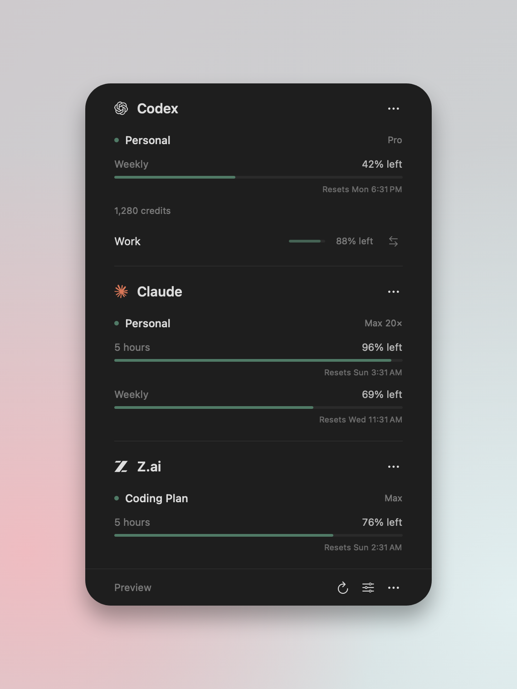
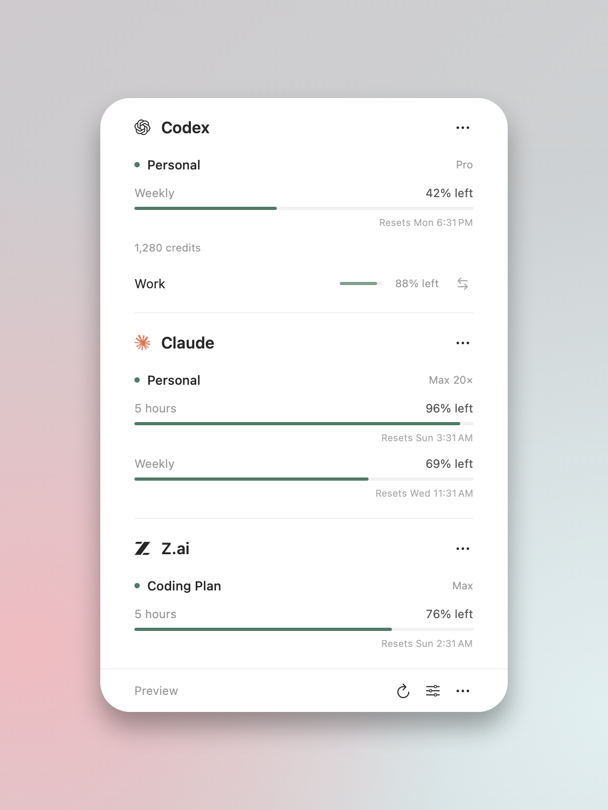
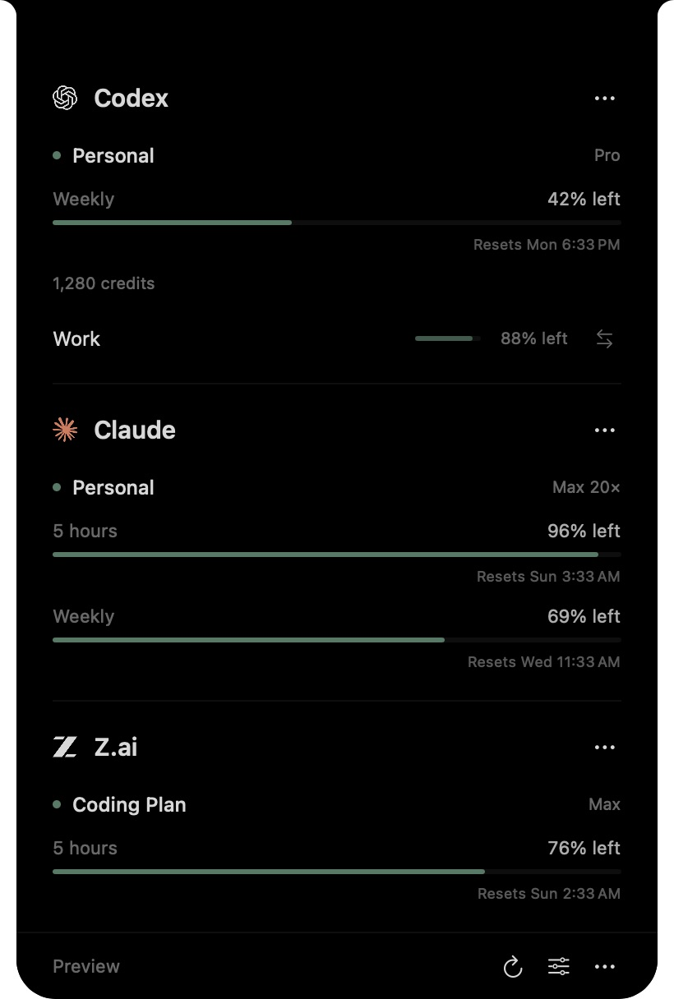
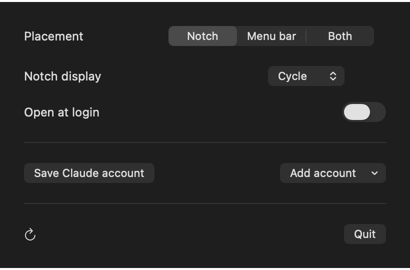
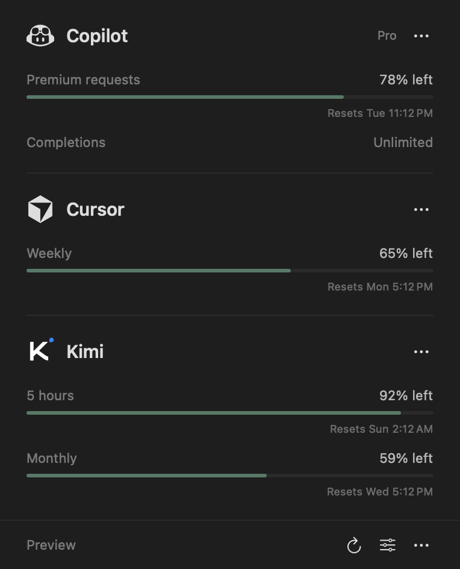
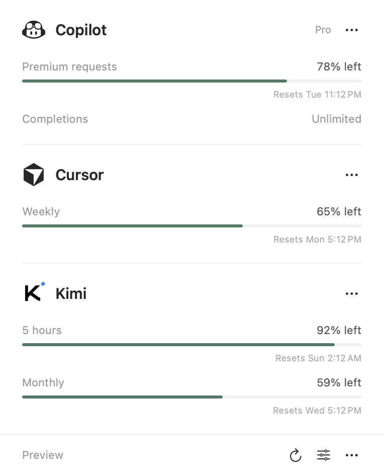

# Sub Tracker

A macOS app for coding subscription usage, from your notch or in the menu bar.

[Download the app](https://github.com/Sagar-CK/sub-tracker/releases) · [Build from source](#build-from-source) · [Contribute](CONTRIBUTING.md)

<p align="center">
  
  
</p>

Providers appear only after an authenticated usage check succeeds. Expired, rejected, and unverified accounts stay hidden.

Choose Notch, Menu bar, or Both in Settings. Macs without a notch use the menu bar.

## Download and install

1. Open [Releases](https://github.com/Sagar-CK/sub-tracker/releases) and download the **universal DMG**.
2. Open the DMG and drag **Sub Tracker** into **Applications**.
3. Open Sub Tracker from Applications. Local sign-ins are detected. Use **Settings → Add account** to connect a subscription key or open a provider’s sign-in.

Requires **macOS 14+**. The same download runs on Apple Silicon and Intel Macs. A ZIP containing the app is also available. No Xcode or Swift installation is needed for the download.

The app is an **unnotarized preview**. If macOS blocks it, you can build from source below or follow [Apple's guidance for opening trusted downloaded apps](https://support.apple.com/en-us/102445). The project does not disable Gatekeeper or remove quarantine. Checksums are included with each release.

To update, quit the app and replace it in Applications. Your local account data stays in place.

## Build from source

Requires **macOS 14+** and a **Swift 6** toolchain (Xcode or Command Line Tools).

If the developer tools are not installed, run `xcode-select --install` first. Check `swift --version`; it must report Swift 6 or later.

```sh
git clone https://github.com/Sagar-CK/sub-tracker.git
cd sub-tracker
./scripts/install.sh
```

Installs `~/Applications/Sub Tracker.app` without administrator access. Accounts and data stay on your Mac.

Hover over the real camera notch to expand usage. Move away to close it. Click the notch to keep it open; click again, click outside, or press Escape to close. Use the sliders button for Settings. The menu bar icon opens the same accounts.

The notch interaction takes inspiration from [Boring Notch](https://github.com/TheBoredTeam/boring.notch). The compact view cycles through active, verified subscriptions every four seconds, with a provider icon and its lowest remaining allowance. It uses curved shoulders around the real cutout. Stale or unknown percentages stay hidden. Choose Cycle or a provider under Settings → Notch display. A pinned provider stays selected across launches and hides if its reading is unavailable. Hover for 300 ms to expand; passing across it briefly does not open it. Reduce Motion is respected.

<p align="center">
  
</p>

<p align="center">
  
</p>

## Provider support

| Provider | Usage | Switching |
| --- | --- | --- |
| Codex / ChatGPT | File-backed local accounts, provider windows, credits | Codex local sign-in files |
| Claude Code | Five-hour, weekly, and model-specific allowances | Saved Claude Code OAuth accounts |
| Z.ai / BigModel | Coding Plan quota through a connected key | Existing Z.ai configuration in Claude Code |
| Gemini | Code Assist model quotas through Gemini CLI OAuth | Managed in Gemini CLI |
| Antigravity | Reported model-group allowances and reset times through `agy` 1.1.11+ | Managed in Antigravity CLI |
| GitHub Copilot | Request allowances, unlimited pools, or reported AI credits | Managed in Copilot |
| Cursor | Editor/CLI sign-in, model pools or shared weekly allowance | Managed in Cursor |
| Kimi | Global and China plans, reported five-hour, weekly, or monthly windows | Managed in Kimi |
| MiniMax | M Plan / Coding Plan allowances and credits | Managed in the coding client |
| Devin / Windsurf | Cache parser available; hidden until a live account can be verified | Managed in Devin |
| Kiro | CLI plan, trial, and overage credits | Managed in Kiro CLI |
| OpenCode Go | Five-hour, weekly, and monthly usage | Managed in OpenCode |

Claude Desktop and ZCode manage their own sign-ins. Keychain-only Codex accounts are not supported. Restart running clients after switching.

Google's individual AI Pro and Ultra coding access moved to [Antigravity](https://developers.google.com/gemini-code-assist/docs/deprecations/code-assist-individuals). Gemini support applies to eligible Code Assist accounts. Sign into `agy` first for Antigravity; an installed CLI alone does not establish a paid plan.

Usage shows provider allowances and credits. Weekly dollar spend appears only when a provider reports it. Monthly bills and estimated costs are not displayed.

<p align="center">
  
  
</p>

See [account discovery and switching](docs/ACCOUNTS.md).

## Status

Version **0.4.2** is an early preview. Codex, Claude, and Cursor have been checked with live accounts. The other integrations have fixture checks and still need live-account validation. Devin/Windsurf cache-only entries are hidden because they cannot verify an account. Kiro currently requires its CLI sign-in. Some providers do not expose a remaining allowance for every plan. Provider endpoints can change.

Downloads and local builds are ad-hoc signed. Developer ID signing and Apple notarization are not configured yet.

## Export an installable app

```sh
./scripts/package.sh --universal
```

Creates an `.app`, `.dmg`, `.zip`, and `SHA256SUMS.txt` in `dist/` for Apple Silicon and Intel. Account data is excluded. Omit `--universal` to build only for your Mac's architecture.

## Development

Built with SwiftUI and AppKit, with no third-party runtime dependencies.

```sh
swift run SubTracker --demo --window
swift run SubTracker --demo --settings
swift run SubTracker --demo --google --window
swift run SubTracker --demo --coding --window
./scripts/check.sh
./scripts/package.sh
```

`--demo` uses sample accounts and makes no provider requests or credential changes. The 50 dependency-free checks run with temporary homes and synthetic credentials. They cover quota parsing, discovery, account identity, safe switching, file permissions, regional keys, read-only SQLite access, CLI version gates, timeouts, process cleanup, and notch hover, pinning, and dismissal.

CI checks Apple Silicon and Intel builds. Version tags publish universal preview downloads after those checks pass. See [CONTRIBUTING.md](CONTRIBUTING.md) and [release instructions](docs/RELEASING.md).

## Privacy

Direct provider requests use an explicit HTTPS allowlist. Antigravity usage runs through the installed CLI and its own network configuration. No analytics, backend, proxy, or browser-cookie extraction. Saved credentials and authentication backups remain local. The app does not need Screen Recording or Accessibility access.

Read [SECURITY.md](SECURITY.md) before reporting a sensitive issue. Never include real credentials or account screenshots in public issues.

## License

[MIT](LICENSE). Provider marks have their own [attribution and ownership notices](THIRD_PARTY_NOTICES.md). Sub Tracker is independent of the supported providers.
